# Домашнее задание к занятию 6 «Создание собственных модулей»

## Ссылки на результат

- Коллекция my_own_namespace.yandex_cloud_elk: https://github.com/DaneenaL/my_own_collection (тег 1.0.0: https://github.com/DaneenaL/my_own_collection/tree/1.0.0)
- Архив tar.gz: https://github.com/DaneenaL/my_own_collection/blob/main/dist/my_own_namespace-yandex_cloud_elk-1.0.0.tar.gz

Необязательную часть (модуль для Yandex Cloud) не делал.

## Подготовка к выполнению

1. Создал пустой публичный репозиторий my_own_collection.
2. Склонировал репозиторий Ansible в домашнюю папку.
3. Создал виртуальное окружение, поставил зависимости, запустил "hacking/env-setup".

**Отличие от текста задания.** У меня Ubuntu 20.04 с Python 3.8.10:

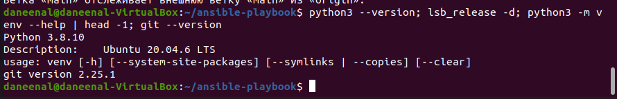

Свежие версии Ansible (ветка devel) требуют более новый Python и на 3.8 не запустятся. Поэтому вместо "git clone https://github.com/ansible/ansible.git" взял ветку, которая поддерживает Python 3.8: "git clone --depth 1 --branch stable-2.13 https://github.com/ansible/ansible.git". Остальные шаги по заданию.

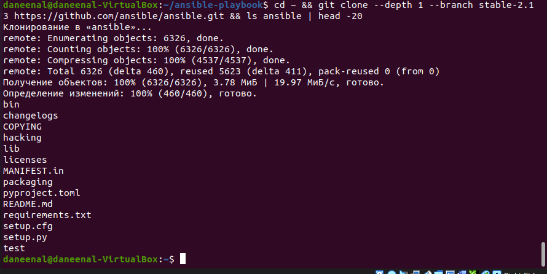

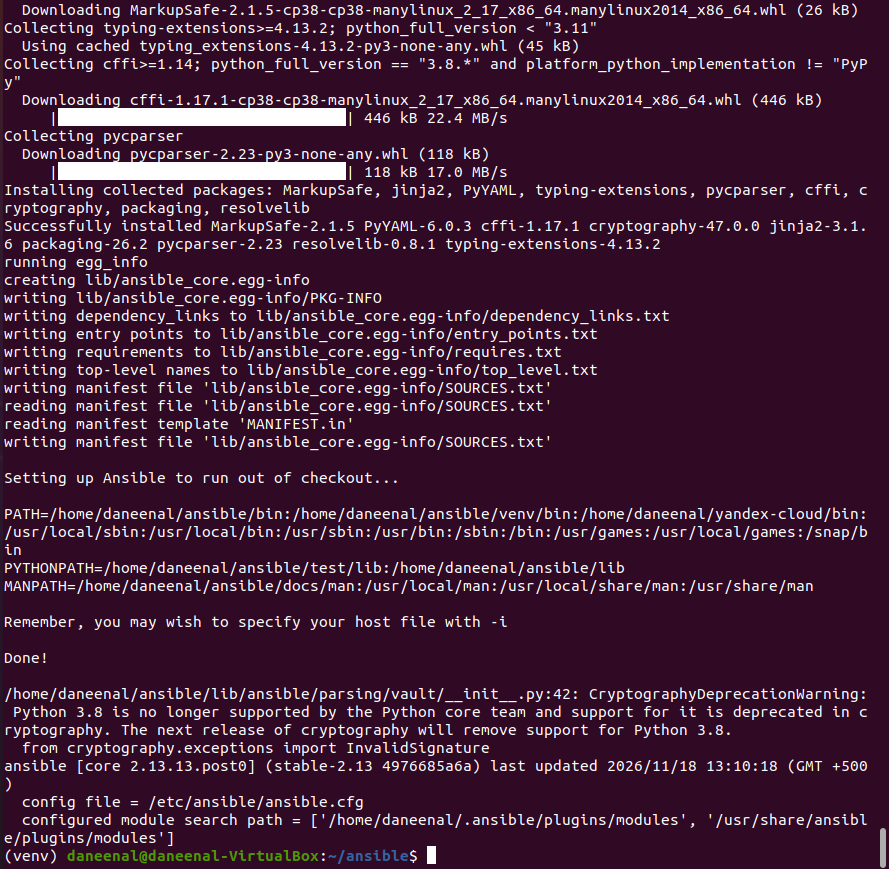

Предупреждение про Python 3.8 в конце вывода от библиотеки cryptography, на работу не влияет.

Потом по заданию вышел из окружения командой deactivate и зашёл обратно конструкцией ". venv/bin/activate && . hacking/env-setup":

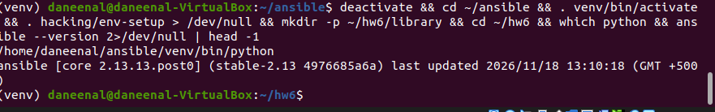

## Основная часть

### Шаги 1-3. Модуль my_own_module

Создал my_own_module.py в рабочей папке hw6/library (внутри venv) и взял за основу шаблон из задания. Что изменил:
- модуль называется my_own_module, параметры "path" и "content" (обязательные, строки) вместо "name" и "new" из шаблона;
- убрал extends_documentation_fragment, потому что такого фрагмента у меня нет и документация без него собирается;
- заполнил DOCUMENTATION, EXAMPLES и RETURN под свою задачу.

Что делает модуль: создаёт текстовый файл по пути path с содержимым content. Если файла нет, создаёт (message "created"). Если файл есть и содержимое другое, перезаписывает ("updated"). Если файл есть и содержимое то же, ничего не трогает ("already up to date", changed false), поэтому модуль идемпотентный. Ещё он поддерживает check mode (считает, изменится ли что-то, но не пишет) и падает с понятной ошибкой, если path это каталог или каталога для файла нет. Полный код в конце.

Документация собирается через ansible-doc:

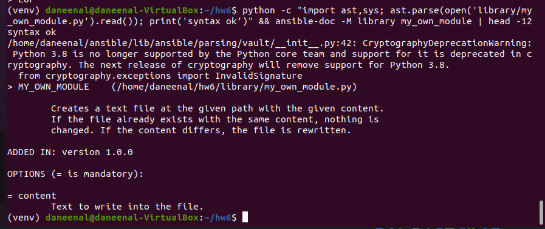

### Шаг 4. Локальная проверка исполняемости

Подготовил файл args.json с параметрами и запустил модуль напрямую дважды. Первый запуск создал файл ("changed": true, "created"), второй ничего не поменял ("changed": false, "already up to date"), в файле нужный текст.

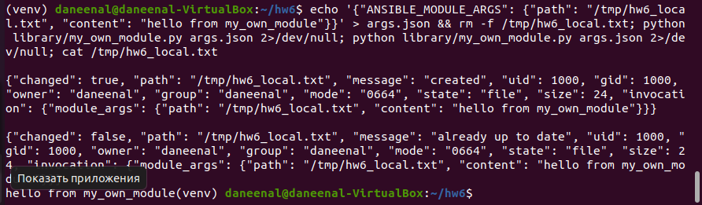

### Шаг 5. Single task playbook

Написал playbook из одной задачи, который вызывает модуль. Хост localhost с подключением local, путь и текст вынес в переменные playbook (в задаче нет захардкоженных значений). Модуль лежит в папке library рядом с playbook, Ansible находит его сам.

### Шаг 6. Проверка идемпотентности через playbook

Запустил playbook два раза подряд. В первом запуске changed=1, во втором changed=0.

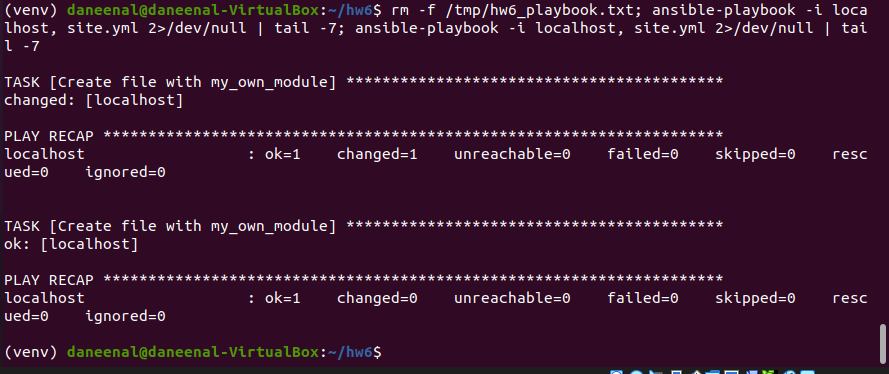

### Шаг 7. Выход из виртуального окружения

Выполнил deactivate. Тут получилась неожиданность: после deactivate команда ansible выдала "Ansible requires Jinja2 3.0 or newer. Current version: 2.10.1". Причина в том, что "hacking/env-setup" прописывает в PATH и PYTHONPATH папку с исходниками Ansible 2.13, а deactivate эти переменные не откатывает, и ansible из исходников запускался системным Python со старым Jinja2.

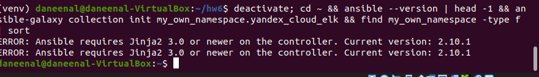

Убрал эти пути из PATH и сбросил PYTHONPATH и MANPATH в этом терминале. После этого снова работает системный ansible 2.9.6:

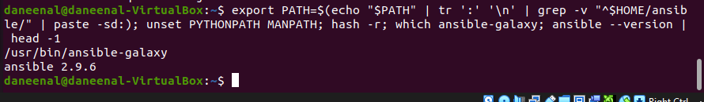

Шаги 8-17 сделаны с системным Ansible 2.9.6 (вне venv), как и требует задание.

### Шаг 8. Инициализация collection

Команда: "ansible-galaxy collection init my_own_namespace.yandex_cloud_elk". Версия 2.9.6 создаёт совсем минимальный каркас (galaxy.yml, README.md, plugins/README.md), остальные папки (plugins/modules, roles, playbooks) добавил сам.

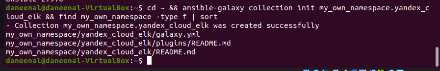

### Шаг 9. Перенос модуля

Модуль лежит в plugins/modules/my_own_module.py. В примерах документации заменил имя на полное имя коллекции (my_own_namespace.yandex_cloud_elk.my_own_module), потому что в коллекции модули вызываются по FQCN.

### Шаг 10. Single task role

Роль file_creator с одной задачей, которая вызывает модуль. В defaults у неё значения для всех параметров модуля: file_creator_path и file_creator_content.

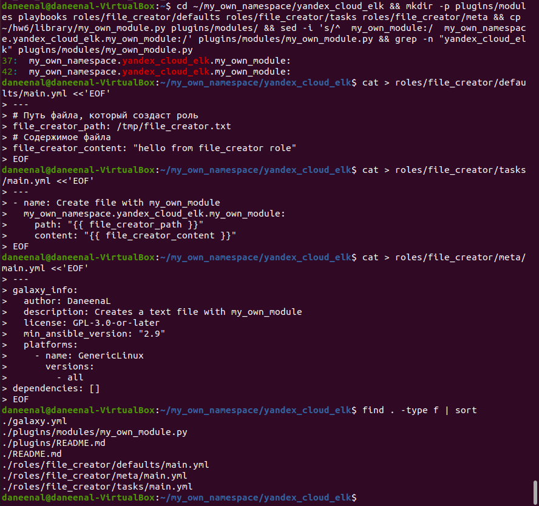

### Шаг 11. Playbook для роли

playbooks/site.yml использует роль file_creator, при этом переопределяет оба параметра своими значениями.

### Шаг 12. Документация, репозиторий, тег 1.0.0

Заполнил galaxy.yml (версия 1.0.0, автор, описание, лицензия, ссылки на репозиторий), README коллекции (состав, параметры модуля, переменные роли, установка) и README роли.

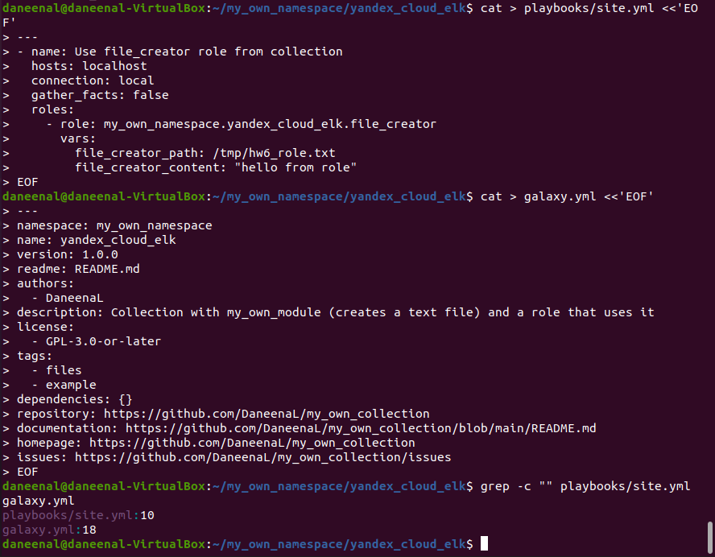

Первая попытка push не прошла: "Repository not found", потому что репозиторий my_own_collection на GitHub у меня ещё не был создан. Создал и повторил.

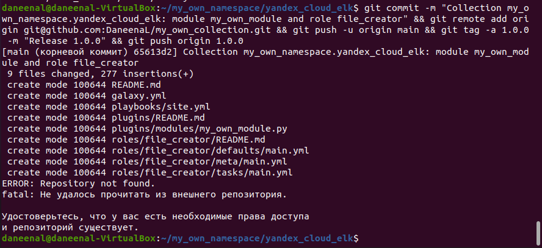

Код выложен в репозиторий, на этот коммит поставил тег 1.0.0:

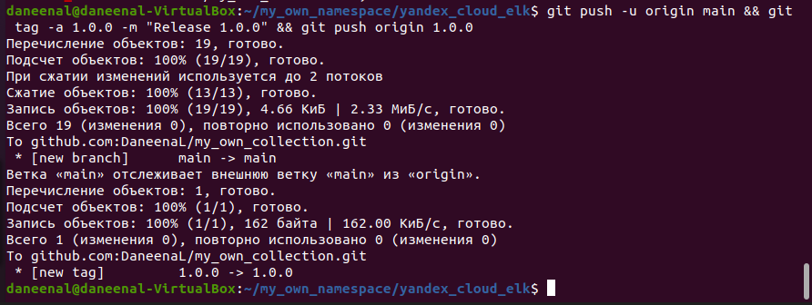

### Шаг 13. Сборка tar.gz

В корне коллекции: "ansible-galaxy collection build". Получился архив my_own_namespace-yandex_cloud_elk-1.0.0.tar.gz.

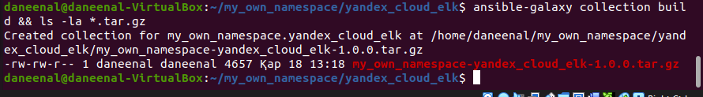

### Шаг 14. Отдельная директория

Создал папку hw6_check, положил туда архив и single task playbook. В playbook модуль уже вызывается по полному имени из коллекции.

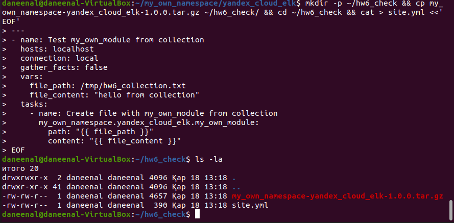

### Шаг 15. Установка collection из локального архива

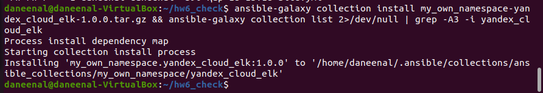

Коллекция встала в ~/.ansible/collections/ansible_collections/my_own_namespace/yandex_cloud_elk. Команды "collection list" в Ansible 2.9 нет, поэтому проверял самим запуском в следующем шаге.

### Шаг 16. Запуск playbook

Запустил playbook из папки hw6_check дважды: первый раз changed=1 и файл создан, второй раз changed=0, в файле "hello from collection".

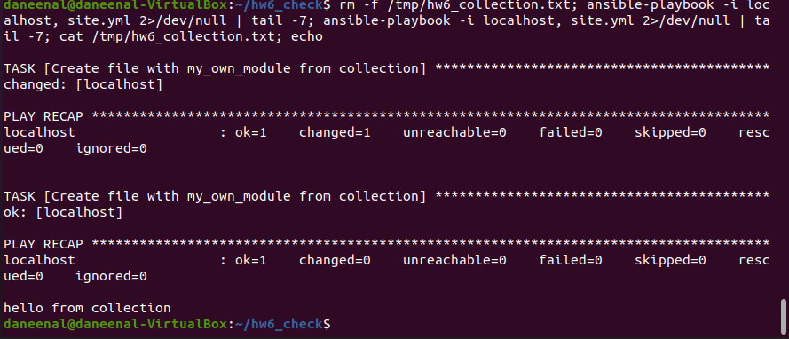

Дополнительно проверил playbook из самой коллекции, который использует роль file_creator (шаги 10-11). Он тоже работает и идемпотентный:

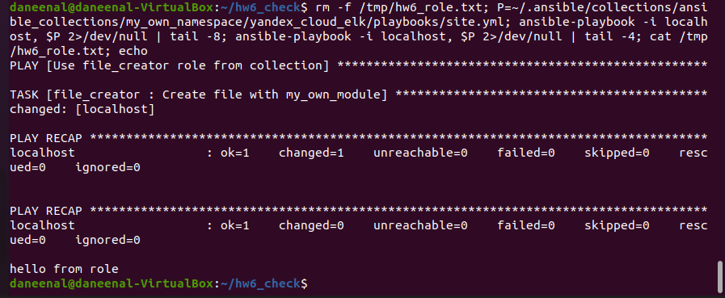

### Шаг 17. Ссылки

Архив tar.gz добавил в репозиторий отдельным коммитом в папку dist, чтобы на него была ссылка. Тег 1.0.0 остался на коммите с кодом коллекции.

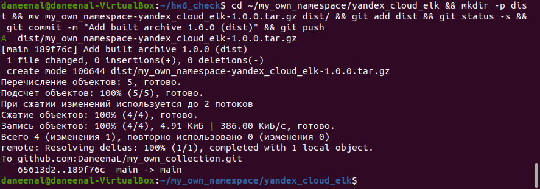

- Коллекция: https://github.com/DaneenaL/my_own_collection
- Архив tar.gz: https://github.com/DaneenaL/my_own_collection/blob/main/dist/my_own_namespace-yandex_cloud_elk-1.0.0.tar.gz

Скриншоты пунктов 4, 6, 15 и 16 приложены выше.

## Код

### plugins/modules/my_own_module.py

```python
#!/usr/bin/python

# Copyright: (c) 2018, Terry Jones <terry.jones@example.org>
# GNU General Public License v3.0+ (see COPYING or https://www.gnu.org/licenses/gpl-3.0.txt)
from __future__ import (absolute_import, division, print_function)
__metaclass__ = type

DOCUMENTATION = r'''
---
module: my_own_module

short_description: Creates a text file with the given content on the remote host

version_added: "1.0.0"

description:
    - Creates a text file at the given path with the given content.
    - If the file already exists with the same content, nothing is changed.
    - If the content differs, the file is rewritten.

options:
    path:
        description: Full path of the file to create on the remote host.
        required: true
        type: str
    content:
        description: Text to write into the file.
        required: true
        type: str

author:
    - DaneenaL (@DaneenaL)
'''

EXAMPLES = r'''
- name: Create a file
  my_own_namespace.yandex_cloud_elk.my_own_module:
    path: /tmp/hello.txt
    content: "hello world"

- name: Rewrite it with new content
  my_own_namespace.yandex_cloud_elk.my_own_module:
    path: /tmp/hello.txt
    content: "new text"
'''

RETURN = r'''
path:
    description: The path of the file the module worked with.
    type: str
    returned: always
    sample: /tmp/hello.txt
message:
    description: What the module did (created, updated or already up to date).
    type: str
    returned: always
    sample: created
'''

import io
import os

from ansible.module_utils.basic import AnsibleModule


def read_current(path):
    """Return current file content or None if the file does not exist."""
    if not os.path.isfile(path):
        return None
    with io.open(path, 'r', encoding='utf-8') as f:
        return f.read()


def run_module():
    module_args = dict(
        path=dict(type='str', required=True),
        content=dict(type='str', required=True)
    )
    result = dict(changed=False, path='', message='')
    module = AnsibleModule(argument_spec=module_args, supports_check_mode=True)

    path = module.params['path']
    content = module.params['content']
    result['path'] = path

    if os.path.isdir(path):
        module.fail_json(msg='path is a directory: %s' % path, **result)
    parent = os.path.dirname(path) or '.'
    if not os.path.isdir(parent):
        module.fail_json(msg='directory does not exist: %s' % parent, **result)

    current = read_current(path)
    if current is None:
        result['changed'] = True
        result['message'] = 'created'
    elif current != content:
        result['changed'] = True
        result['message'] = 'updated'
    else:
        result['message'] = 'already up to date'

    if result['changed'] and not module.check_mode:
        try:
            with io.open(path, 'w', encoding='utf-8') as f:
                f.write(content)
        except (IOError, OSError) as e:
            module.fail_json(msg='cannot write %s: %s' % (path, e), **result)

    module.exit_json(**result)


def main():
    run_module()


if __name__ == '__main__':
    main()
```

### roles/file_creator/defaults/main.yml

```yaml
---
# Путь файла, который создаст роль
file_creator_path: /tmp/file_creator.txt
# Содержимое файла
file_creator_content: "hello from file_creator role"
```

### roles/file_creator/tasks/main.yml

```yaml
---
- name: Create file with my_own_module
  my_own_namespace.yandex_cloud_elk.my_own_module:
    path: "{{ file_creator_path }}"
    content: "{{ file_creator_content }}"
```

### roles/file_creator/meta/main.yml

```yaml
---
galaxy_info:
  author: DaneenaL
  description: Creates a text file with my_own_module
  license: GPL-3.0-or-later
  min_ansible_version: "2.9"
  platforms:
    - name: GenericLinux
      versions:
        - all
dependencies: []
```

### playbooks/site.yml

```yaml
---
- name: Use file_creator role from collection
  hosts: localhost
  connection: local
  gather_facts: false
  roles:
    - role: my_own_namespace.yandex_cloud_elk.file_creator
      vars:
        file_creator_path: /tmp/hw6_role.txt
        file_creator_content: "hello from role"
```

### galaxy.yml

```yaml
---
namespace: my_own_namespace
name: yandex_cloud_elk
version: 1.0.0
readme: README.md
authors:
  - DaneenaL
description: Collection with my_own_module (creates a text file) and a role that uses it
license:
  - GPL-3.0-or-later
tags:
  - files
  - example
dependencies: {}
repository: https://github.com/DaneenaL/my_own_collection
documentation: https://github.com/DaneenaL/my_own_collection/blob/main/README.md
homepage: https://github.com/DaneenaL/my_own_collection
issues: https://github.com/DaneenaL/my_own_collection/issues
```

### hw6_check/site.yml (single task playbook)

```yaml
---
- name: Test my_own_module from collection
  hosts: localhost
  connection: local
  gather_facts: false
  vars:
    file_path: /tmp/hw6_collection.txt
    file_content: "hello from collection"
  tasks:
    - name: Create file with my_own_module from collection
      my_own_namespace.yandex_cloud_elk.my_own_module:
        path: "{{ file_path }}"
        content: "{{ file_content }}"
```
